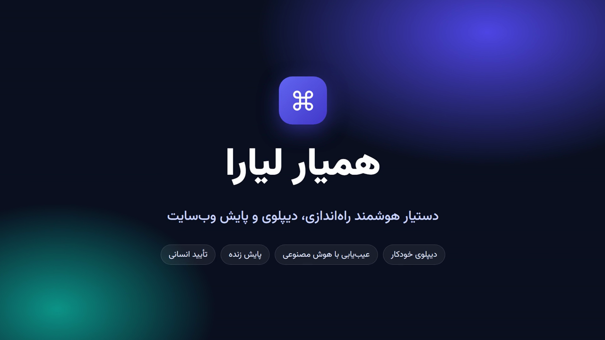
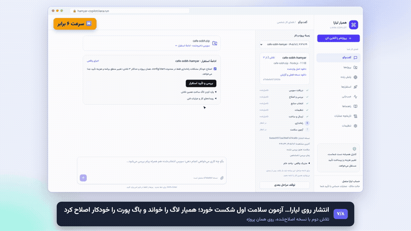
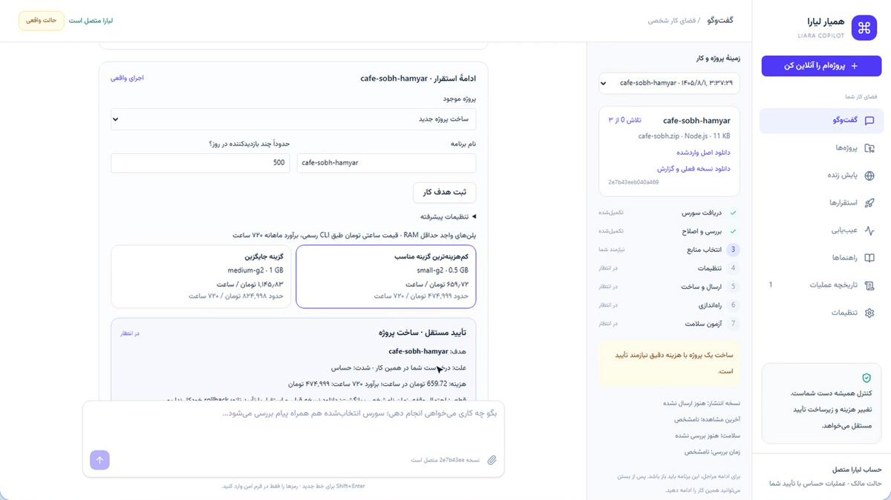
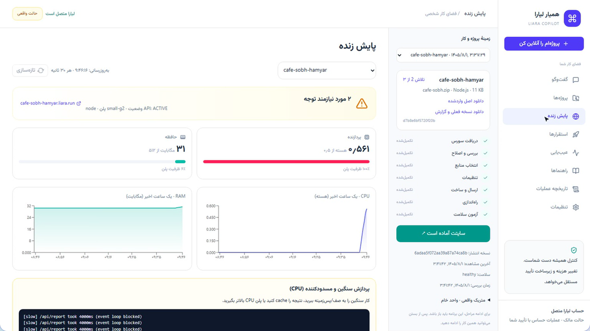
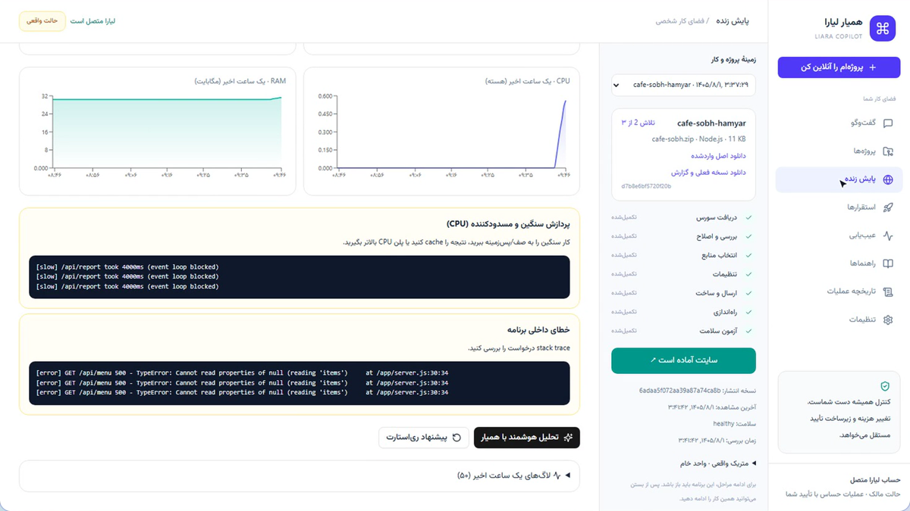
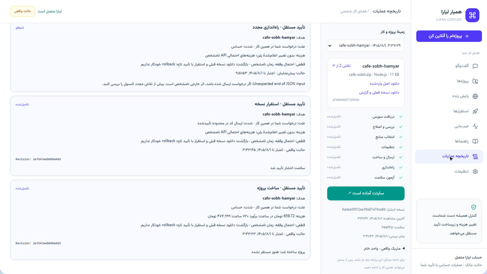
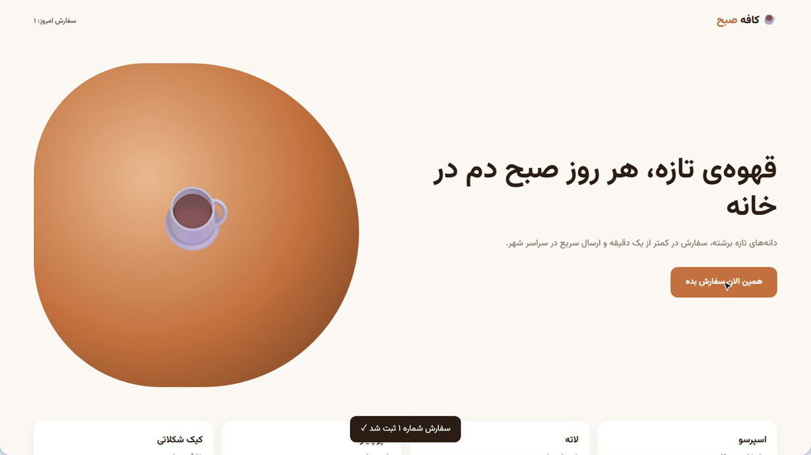
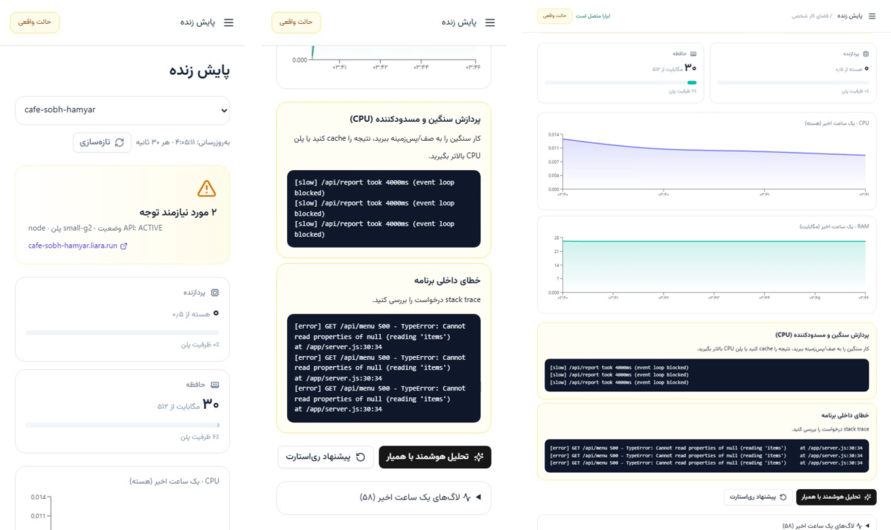
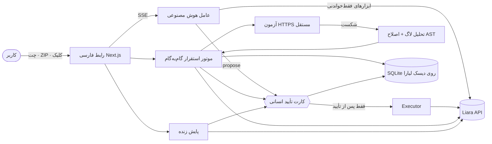

<div align="center">

# 🤖 همیار لیارا · Liara Copilot

### دستیار هوشمند راه‌اندازی، دیپلوی، پایش و عیب‌یابی وب‌سایت روی زیرساخت لیارا

[](https://hamyar-copilot.liara.run)
[](https://hamyar-copilot.liara.run/demo.mp4)


<br />

### 🎬 ویدیوی کامل معرفی و دمو پروژه (۵ دقیقه)
*جهت تماشای آنلاین یا دانلود ویدیو، روی کادر زیر کلیک کنید:*

[](https://hamyar-copilot.liara.run/demo.mp4)

**[▶ برای تماشای مستقیم ویدیوی دمو با کیفیت اصلی کلیک کنید](https://hamyar-copilot.liara.run/demo.mp4)**  
<sub>همه صحنه‌ها اجرای واقعی روی حساب لیارا هستند؛ هیچ بخشی شبیه‌سازی نشده است.</sub>

---

</div>

<div dir="rtl">

## 🎯 سناریوی ویدیوی دمو

<div align="center"></div>

در ویدیوی ۵ دقیقه‌ای بالا، سناریوی کامل راه‌اندازی و رفع خطا به صورت زنده نمایش داده می‌شود:
1. **آپلود سورس:** سایت نمونه «کافه صبح» با دو باگ راه‌اندازی آپلود می‌شود.
2. **تحلیل و اصلاح خودکار:** همیار مشکلات را به شکل diff مشخص و پیشنهاد اصلاح می‌دهد.
3. **انتخاب منابع:** پلن مناسب بر اساس مشخصات پروژه با قیمت واقعی پیشنهاد می‌گردد.
4. **ساخت و دیپلوی:** با تأیید صریح کاربر، پروژه روی لیارا ایجاد و اولین انتشار آغاز می‌شود.
5. **برخورد با خطا در آزمون سلامت:** آزمون سلامت اول **شکست می‌خورد**.
6. **عیب‌یابی با لاگ و اصلاح AST:** همیار لاگ خطا را بررسی کرده، باگ پورت را با تحلیل AST اصلاح و نسخه جدید را مجدداً منتشر می‌کند.
7. **پایش زنده و پایداری:** سایت آماده و آنلاین می‌شود، در ادامه با ایجاد بار ترافیکی و خطای ۵۰۰، علت از روی لاگ تشخیص داده شده و با تأیید انسانی ری‌استارت انجام می‌شود.

---

## ✨ قابلیت‌ها

| | قابلیت | جزئیات |
|---|---|---|
| 🚀 | **از سورس تا سایت آنلاین** | آپلود ZIP یا GitHub عمومی، تشخیص پشته/پورت/متغیرها، پیشنهاد اصلاح به شکل diff، انتخاب پلن با قیمت واقعی، ساخت پروژه و انتشار |
| 🔧 | **اصلاح خودکار** | اسکریپت start غایب، liara.json، باگ پورت Express (تحلیل AST، نه regex)؛ حداکثر ۳ تلاش و ۳۰ دقیقه |
| ✅ | **تأیید سلامت واقعی** | موفقیت فقط وقتی اعلام می‌شود که همان انتشار READY باشد و دو آزمون HTTPS مستقل موفق شوند |
| 📈 | **پایش زنده** | وضعیت سرویس، CPU و RAM نسبت به ظرفیت پلن، نمودار یک ساعت اخیر، لاگ‌ها؛ تازه‌سازی هر ۳۰ ثانیه |
| 🧠 | **عیب‌یابی هوشمند** | تشخیص الگو از لاگ واقعی (پردازش مسدودکننده، خطای ۵۰۰، کمبود حافظه، پورت، دیتابیس…) + عامل هوش مصنوعی با ابزارهای امن |
| 🛡️ | **Human-in-the-Loop** | هر عملیات حساس (ساخت، دیپلوی، ری‌استارت، تغییر پلن، env، حذف) کارت تأیید مستقل با هزینه، اثر، راه بازگشت و انقضا دارد |
| 📱 | **همه‌جا** | رابط فارسی راست‌به‌چپ، کاملاً واکنش‌گرا برای موبایل، تبلت و دسکتاپ |

<table>
<tr>
<td width="50%"><br><sub>پیشنهاد پلن و کارت تأیید مستقل ساخت پروژه</sub></td>
<td width="50%"><br><sub>پایش زنده: هشدار CPU نزدیک سقف پلن</sub></td>
</tr>
<tr>
<td><br><sub>تشخیص خودکار علت‌ها از لاگ واقعی</sub></td>
<td><br><sub>تاریخچه کامل عملیات و تأییدها</sub></td>
</tr>
<tr>
<td><br><sub>سایت نمونه، دیپلوی‌شده توسط همیار</sub></td>
<td><br><sub>پشتیبانی کامل از موبایل و تبلت</sub></td>
</tr>
</table>

---

## 🏗️ معماری



| مسیر | نقش |
|---|---|
| `components/copilot-app.tsx` | رابط گفت‌وگومحور، پنل کار، مراحل و کارت‌های تأیید |
| `components/monitor-panel.tsx` | پایش زنده CPU/RAM، نمودارها، لاگ و یافته‌ها |
| `app/api/agent` | حلقه عامل هوش مصنوعی (حداکثر ۵ دور، ۹۰ ثانیه) با ابزارهای whitelist |
| `app/api/jobs` · `lib/copilot/jobs.ts` | ماشین حالت استقرار با lease اتمیک، سقف تلاش و بودجه زمانی |
| `app/api/liara` · `lib/copilot/executor.ts` | خواندن حساب/شواهد و اجرای عملیات تأییدشده |
| `lib/copilot/liaraClient.ts` | کلاینت تایپ‌شده (zod) برای APIهای لیارا |
| `lib/copilot/startup-patch.ts` | اصلاح محدود و اثبات‌پذیر کد با AST تایپ‌اسکریپت |
| `lib/copilot/health.ts` | آزمون HTTPS با TLS معتبر، رد IP خصوصی و محدودیت زمان/حجم |

---

## 🔌 اتصال به APIهای لیارا

توکن فقط سمت سرور است (`Authorization: Bearer`) و با `LIARA_TEAM_ID` روی حساب تیم کار می‌کند. GETها retry با backoff دارند؛ درخواست‌های تغییر‌دهنده **هرگز** خودکار تکرار نمی‌شوند.

| دسته | Endpoint |
|---|---|
| حساب و کاتالوگ | `GET /v1/me` · `GET /v1/billing` · `GET /v1/projects` |
| ساخت | `POST /v1/networks` · `POST /v1/projects` |
| انتشار | `POST /v2/projects/{name}/sources` · `POST /v2/projects/{name}/releases` · `GET …/releases` |
| شواهد | `GET /v2/projects/{name}/logs` · `GET …/metrics/summary` · `GET …/metrics/{cpu\|memory}` · `GET …/events` |
| عملیات | `POST …/actions/restart` · `POST …/actions/scale` · `POST …/resize` · `POST /v1/projects/update-envs` |
| دامنه و منابع | `GET/POST /v1/domains` · `GET /v1/domains/{id}/check` · `GET …/disks` · `GET /v1/databases` |

قبل از ارسال هر متن به مدل زبانی، توکن‌ها، connection stringها و مقدار متغیرهای محیطی پروژه حذف (redact) می‌شوند. لاگ و سورس کاربر «شواهد غیرقابل اعتماد» هستند و دستورهای داخلشان اجرا نمی‌شود.

---

## 👤 نحوه تعامل کاربر

1. **ورود:** صفحه بدون ثبت‌نام باز می‌شود (تحلیل سورس برای همه آزاد است). مالک با «کلید مالک» در تنظیمات به حساب لیارا متصل می‌شود.
2. **«پروژه‌ام را آنلاین کن»:** فایل ZIP را رها کنید؛ مراحل در پنل کناری با وضعیت هر مرحله نمایش داده می‌شود.
3. **تصمیم‌ها همیشه با شماست:** پیش‌فرض «پیش‌نمایش بدون تغییر» است. در «حالت واقعی» هم هر عملیات حساس یک کارت تأیید جداگانه دارد؛ دستور مدل هرگز تأیید محسوب نمی‌شود.
4. **پایش و گفت‌وگو:** «پایش زنده» سلامت را نشان می‌دهد و «تحلیل هوشمند با همیار» شواهد را برای عامل می‌فرستد؛ می‌توانید به زبان ساده بپرسید «چرا سایتم کنده؟».

| سطح ریسک | نمونه | رفتار |
|---|---|---|
| خواندنی | فهرست پروژه، لاگ، متریک | خودکار |
| محدود | اصلاح config/start در همان پروژه | خودکار فقط با اجازه صریح «اصلاح خودکار» |
| حساس | ساخت، دیپلوی، ری‌استارت، تغییر پلن، env، حذف | کارت تأیید مستقل + ثبت در تاریخچه |

---

## ⚠️ محدودیت‌ها (شفاف با کاربر)

| مورد | وضعیت |
|---|---|
| لاگ build | از API در دسترس نیست؛ کاربر می‌تواند از کنسول کپی و به همان تلاش پیوست کند |
| rollback خودکار | endpoint ندارد؛ بازگشت = استقرار نسخه قبلی با تأیید تازه |
| applets endpoint | در حال حاضر خطای ۵۰۰ می‌دهد؛ همیار بدون آن و با release + آزمون HTTPS ادامه می‌دهد |
| ETag / به‌روزرسانی شرطی env | وجود ندارد؛ تغییر هم‌زمان از کنسول قابل تشخیص اتمیک نیست |
| SSL و دامنه سفارشی | ثبت از API؛ مراحل DNS در پنل ثبت دامنه (مثل ایرنیک) با راهنمای همیار توسط کاربر |
| پیشرفت خودکار | worker پس‌زمینه ندارد؛ برای ادامه مراحل، صفحه باید باز باشد |

---

## 🛠️ راهنمای اجرا

```bash
# نصب وابستگی‌ها
pnpm install

# اجرای سرور توسعه
pnpm dev
```

متغیرهای محیطی (`.env`):

```env
LIARA_API_TOKEN=      # توکن API لیارا
LIARA_TEAM_ID=        # شناسه تیم (اختیاری)
LLM_API_KEY=          # کلید مدل سازگار با OpenAI
LLM_BASE_URL=         # مثلاً https://api.example.com/v1
LLM_MODEL=            # نام مدل با پشتیبانی tool calling
OWNER_KEY=            # کلید مالک برای فعال‌سازی عملیات حساب
COPILOT_DB_PATH=/data/copilot.sqlite
```

**دیپلوی روی لیارا** (Dockerfile و `liara.json` آماده است؛ دیسک `data` روی `/data`):

```bash
liara deploy --app hamyar-copilot --platform docker --port 3000
```

مستندات فنی کامل‌تر: [docs/TECHNICAL.md](docs/TECHNICAL.md)

</div>
