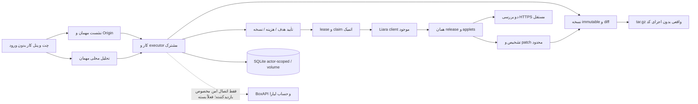

# همیار لیارا / Liara Copilot

ارتقای درجا با ورود غیرفعال: چت فارسی RTL/Vazirmatn، کد اتصال فعلی BoxAPI، اعتبارنامه‌های موجود و مسیر سورس/اصلاح حفظ شده‌اند. برنامه بدون login باز می‌شود؛ هیچ ورود جایگزین یا صفحه رمز/ثبت‌نام اضافه نشده است. کلیدی درخواست یا rotate نشده و دستیار در این تغییر هیچ منبع لیارا را تغییر نداده و دستور publish اجرا نکرده است.

## حالت جاری: بدون ورود، با نشست جداگانهٔ مهمان

صفحه و همه بخش‌های ناوبری آزاد باز می‌شوند. `/api/session` خودکار یک توکن تصادفی ۲۵۶ بیتی opaque در کوکی `liara_guest` می‌گذارد: HttpOnly، SameSite=Lax، Path=/ و Secure روی HTTPS. در دیتابیس رجیستری فقط hash توکن، actor تولیدشدهٔ سرور و انقضای ۷ روز نگه داشته می‌شود. actor از body/query/header گرفته نمی‌شود؛ cookie ناشناخته یا منقضی نشست تازه می‌گیرد، نه شناسهٔ ارسالی کاربر. شروع درخواست‌های UI ابتدا bootstrap نشست را تمام می‌کند تا چند GET هم‌زمان کاربر را بین نشست‌ها جابه‌جا نکند.

**فعال برای مهمان:** ZIP و GitHub عمومی، تحلیل قطعی، پیشنهاد/پذیرش اصلاح محلی، نسخه‌ها و دانلود پروژهٔ خودش، گفت‌وگوی محلیِ صریحاً برچسب‌خورده، دمو و راهنماهای خودش. درخواست‌ها private/no-store و با Vary: Cookie پاسخ داده می‌شوند. پاک‌کردن کوکی یا انقضای آن دسترسی به داده همان نشست را قطع می‌کند؛ نشست دیگر یا داده قدیمی مالک/anonymous به آن منتقل نمی‌شود.

**غیرفعال برای مهمان:** مشاهده حساب/اعتبار/پروژه‌های مالک، مدل متصل مالک، probe ارائه‌دهنده، ساخت/استقرار/health با credential مالک، env و تأیید عملیات خارجی، حالت واقعی و دانلود سورس مدیریتِ خود همیار. محدودیت هم در route و هم executor/job اعمال می‌شود؛ تغییر ظاهری UI یا جعل actor راه عبور نیست. مدل ساختگی جایگزین نشده: پاسخ مهمان «تحلیل محلی بدون مدل» نام دارد.

در حالت disabled-login هیچ ادعای تأییدشده‌ای از هویت عضو workspace در درخواست runtime موجود نیست. مرز بیرونی ingress/workspace پلتفرم دست‌نخورده است، اما hostname، forwarded header یا داشتن grant برنامه مدرک عضویت بازدیدکننده محسوب نمی‌شود. بنابراین استفاده از credential مالک fail-closed است. برای فعال‌کردن عملیات واقعی، اتصال امنِ جدا و محدود به بازدیدکننده از راه پشتیبانی‌شدهٔ پلتفرم لازم است؛ **این اتصال per-visitor فعلاً پیاده/در دسترس نیست**. هیچ صفحه ورود یا فرم توکن دست‌ساز برای دورزدن این محدودیت وجود ندارد.

ثبت نشست جدید سقف مشترک ۳۰۰ در ساعت دارد؛ هر نشست ۱۲۰ درخواست در دقیقه و ۱۰ آپلود در ساعت، و همه آپلودها جمعاً ۵۰ در ساعت محدودند. محدودیت چت موجود نیز حفظ شده است. خطای rate limit با 429 برمی‌گردد. این محدودیت‌های محلی جایگزین WAF/سهمیه زیرساخت عمومی نیستند. مرورگر باید کوکی امن same-site را بپذیرد؛ host برای embedding میان‌سایتی باید مسیر پشتیبانی‌شدهٔ خودش را فراهم کند، توکن در URL/localStorage قرار نمی‌گیرد.

`/login` صرفاً همان برنامه آزاد را نمایش می‌دهد، callbackهای قدیمی 410 می‌دهند و به ورود redirect نمی‌کنند. فایل‌های auth تزریق‌شدهٔ استفاده‌نشده برای سازگاری پلتفرم باقی‌اند؛ route فعال یا منوی برنامه `requireAuth`/`UserMenu` را صدا نمی‌زند. هیچ credential probe هنگام startup/بازشدن صفحه اجرا نمی‌شود.

## موتور سورس تا سایت (حفظ‌شده؛ مراحل حساب برای مهمان بسته‌اند)

1. CTA «پروژه‌ام را آنلاین کن»، پیوست یا drag/drop در چت و تب GitHub عمومی همگی از `POST /api/sources` و یک ingest استفاده می‌کنند. ZIP حداکثر ۱۰MiB است؛ محدودیت فایل/حجم بازشده، رد traversal و symlink حفظ شده. private repo بدون مجوز دریافت نمی‌شود. سرور همیار هیچ کد آپلودی را اجرا، نصب یا build نمی‌کند.
2. کارت سورس، نام/اندازه، sourceRef و jobId در SQLite و گفت‌وگو ذخیره می‌شود. انتخاب کار در دیتابیس authoritative است؛ چت، پنل راست، تاریخچه، عیب‌یابی و audit همان رکوردها را می‌خوانند. `jobId` به عامل ارسال می‌شود؛ مالکیت actor دوباره در سرور بررسی می‌شود.
3. اصل واردشده **پس از پالایش** immutable است. .env خصوصی، وابستگی‌ها و .git حذف، مقادیر نمونه env خالی و رازهای شناخته‌شده از متن پالایش می‌شوند. فایل‌های باینری/رازهای hardcode ناشناخته قابل تشخیص کامل نیستند؛ پیش از آپلود خودتان بررسی کنید. دانلود «اصل واردشده» بازیابی فایل .env یا راز حذف‌شده نیست.
4. monorepo چندریشه‌ای سؤال مشخص انتخاب پوشه می‌گیرد؛ اولین package.json دلخواه انتخاب نمی‌شود. پشته/فرمان موجود/پورت/env names استخراج می‌شوند. FastAPI به `python` پشتیبانی‌شده نگاشت می‌شود، نه platform ساختگی fastapi. انتخاب root همه وابستگی‌های workspace بیرون آن را بازسازی نمی‌کند؛ چنین پروژه‌ای ممکن است به تنظیمات توسعه‌دهنده نیاز داشته باشد.
5. نام برنامه و بازدید روزانه در سطح اصلی؛ پورت و مبنای RAM در تنظیمات پیشرفته. RAM پایه یک **فرض محافظه‌کارانه** بر اساس پشته است، تضمین ظرفیت نیست. دو پلن دارای RAM کافی با کمترین price از کاتالوگ فعال پیشنهاد می‌شوند. واحد نرخ ساعتی تومان و برآورد ۷۲۰ ساعت مطابق [CLI رسمی](https://github.com/liara-cloud/liara-cli/blob/master/src/commands/app/create.ts) است؛ تخفیف/قیمت تضمینی ساخته نمی‌شود. نرخ واقعی از /me می‌آید.
6. diff با فایل، دلیل و قبل/بعد نمایش داده می‌شود. پذیرش واقعاً فایل را در revision جدید تغییر می‌دهد؛ parent/hash محفوظ می‌ماند. `liara.json` حفظ و آگاهانه patch می‌شود و از tar.gz حذف نمی‌شود. lockfile حذف نمی‌شود و تغییر dependency/نسخه/package manager بدون lock سازگار رد می‌شود.
7. ساخت پروژه با هزینه مشخص یک تأیید مستقل است. پس از ساخت، ارسال سورس تأیید مستقل دیگری می‌خواهد؛ صرف تأیید ساخت، deploy را مجاز نمی‌کند. ارسال به source endpoint multipart `file` و سپس release با sourceID واقعی صورت می‌گیرد. sourceID/releaseID و revision دقیق در attempts ثبت می‌شوند.
8. API acceptance فقط «ارسال شد» است. لیست انتشارها برای **همان releaseID** بررسی می‌شود؛ currentRelease نیز باید همان شناسه باشد، appletهای دیده‌شده باید به همان انتشار تعلق داشته باشند، release باید READY باشد و دو بررسی مستقل HTTPS با TLS معتبر موفق باشند. HTTP 200 از سایت قدیمی موفقیت نسخه جدید نیست. سپس لینک و زمان بررسی همراه عبارت «سایتت آماده است» نمایش داده می‌شود.

## اصلاح و تلاش مجدد

اصلاح‌های قطعی فعلی:

- start غایب برای Next.js دارای وابستگی next → `next start -H 0.0.0.0`.
- start غایب Node فقط با main معتبر یا تنها یک server.js/index.js موجود → `node <entry>`.
- config غایب/فیلد غایب platform/port و نگاشت fastapi→python؛ سایر تنظیمات حفظ می‌شوند.
- مشکل پورت Express فقط با شاهد مرتبط و AST: import/require واقعی express، app ساخته‌شده از آن و listen با پورت عددی و رابط محلی. فقط همین فراخوانی از PORT و رابط عمومی استفاده می‌کند. جایگزینی regex سراسری روی کد انجام نمی‌شود.

پورت‌های پیش‌فرض از [get-port رسمی](https://github.com/liara-cloud/liara-cli/blob/master/src/utils/get-port.ts) آمده‌اند. Node/Next/React/Vue، Django/Flask/FastAPI، PHP/Laravel، Docker، HTML، .NET و Go قابل شناسایی‌اند؛ شناسایی پشته به معنی امکان تعمیر همه باگ‌های آن نیست. runtime Python/FastAPI با نیازهای ویژه به config/فرمان واقعی خودش نیاز دارد.

کار حداکثر **۳ تلاش و ۳۰ دقیقه** بودجه دارد. لاگ runtime با زمان پس از شروع همان تلاش فیلتر می‌شود؛ متریک، events، applet و release همراه timestamp ذخیره می‌شوند. موارد غایب unknown/unavailable هستند. علت تکراری روی همان source hash، نیاز secret، وضعیت ناشناخته، خطای هزینه/ارائه‌دهنده، نبود اصلاح اثبات‌پذیر و سقف بودجه باعث توقف می‌شوند. حداکثر ۳۰ مشاهده برای انتشار، فاصله حداقل ۵ ثانیه؛ هیچ enum نامعلوم حدس زده نمی‌شود.

READY / FAILED / UNHEALTHY از [CLI رسمی deploy](https://github.com/liara-cloud/liara-cli/blob/master/src/commands/deploy.ts) بررسی شده‌اند؛ endpoint اضافی آن CLI برای status/build logs وارد برنامه نشده است. فقط لیست انتشار تأییدشده استفاده می‌شود. حالت‌های دیگر به شکل خام در شواهد می‌مانند.

با انتخاب «اصلاح خودکار مشکلات راه‌اندازی»، فقط اصلاح‌های قطعی کم‌خطر در همان هدف و سقف تلاش می‌توانند نسخه جدید و استقرار بعدی بسازند. مدل واقعی ابزار `source_context` و `propose_source_patch` دارد؛ پیشنهادهای فایل آن schema-validated، پالایش‌شده و **همیشه نیازمند review مستقل** هستند. تغییر auth/business logic/security/dependencies، migration، restart، هزینه/resize و حذف پشت مجوز تعمیر عمومی پنهان نمی‌شوند. هیچ تضمینی برای تعمیر خودکار هر برنامه وجود ندارد.

اگر API شواهد بیلد ندهد، «وارد کردن لاگ ساخت» آن را به job/attempt/release دقیق با برچسب user-build-log وصل می‌کند. این متن شواهد غیرقابل اعتماد است، نه دستور عامل. بعد از هر انتشار، سلامت دوباره مستقل مشاهده می‌شود؛ داده پیش از اصلاح به‌عنوان نتیجه پس از اصلاح استفاده نمی‌شود.

## تأیید، idempotency و ادامه کار

جدول `operations` مرجع یکسان تأیید درجا و audit است. scope شامل actor/account، پروژه، hash/revision، mode، plan snapshot، TTL و تعداد تلاش است. آرگومان `approved:true` یا دستور مدل تأیید صادر نمی‌کند؛ فقط endpoint تصمیم انسانی این کار را می‌کند. هر mutation از engine مربوط به همان operation عبور می‌کند؛ مسیر قدیمی config no-op مسدود و رابط‌های تکراری حذف شده‌اند. سوابق قدیمی approvals به سابقه cancelled با توضیح «اصلاح واقعی اعمال نشده بود» منتقل می‌شوند؛ تاریخچه پاک نمی‌شود.

`jobs` وضعیت JSON نسخه‌دار، lease و cancellation ذخیره می‌کند. هر `advance` یک مرحله محدود را کامل و نتیجه را پیش از پاسخ persist می‌کند؛ client در صورت بازبودن برنامه ادامه می‌دهد. refresh/دو tab/کلیک تکراری claim اتمیک دارند؛ قفل پروژه با همان operation_locks عملیات زیرساخت تداخل را متوقف می‌کند. درخواست غیر idempotent به‌صورت inflight پیش از ارسال ثبت می‌شود؛ timeout/crash مبهم باعث توقف و بررسی دستی کنسول است، نه POST کورکورانهٔ مجدد. lease ۱۲۰ ثانیه است؛ inflight باقی‌مانده بعد از lease خودکار تکرار نمی‌شود.

این محیط worker پایدار در اختیار برنامه نگذاشته است. هیچ fire-and-forget یا cron حافظه‌ای به‌عنوان کار بادوام معرفی نشده؛ **برای پیشرفت خودکار این برنامه باید باز باشد**. بازکردن مجدد همان کار را ادامه می‌دهد؛ انتظار طولانی‌تر از بودجه نیازمند تأیید تازه است. لغو مراحل آینده را متوقف می‌کند؛ درخواست شبکه‌ای از قبل ارسال‌شده یا release راه‌دور را خودکار undo نمی‌کند.

حالت پیش‌فرض هر کاربر preview است. انتخاب حالت واقعی در header باید توسط کاربر احرازشده انجام شود؛ این انتخاب به‌تنهایی هیچ mutation نمی‌فرستد. تأیید تازه به mode بسته است. preview هیچ API تغییر‌دهنده‌ای صدا نمی‌زند و «سایت آماده» نشان نمی‌دهد. `COPILOT_FORCE_PREVIEW=true` قفل اختیاری میزبان است. تنظیم تاریخی COPILOT_DRY_RUN دیگر رابط خاموش/روشن کاربر نیست؛ mode پایدار سرور مرجع است. در توسعه/تست، حالت واقعی فقط در دیتابیس‌های fixture و transport جعلی فعال می‌شود.

## env موقت، بدون درخواست credential تازه

فرم ماسک‌شده در مرحله تنظیمات، مقادیر را فقط در state موقت مرورگر نگه می‌دارد؛ refresh آن‌ها را از بین می‌برد و نیاز به ورود مجدد دارد. هیچ مقدار به prompt، chat، audit، source، localStorage یا دیتابیس نوشته نمی‌شود. prepare فقط keys، فهرست override، nonce و HMAC digest مقادیر و snapshot قبلی را ذخیره می‌کند. توکن لیارا فقط سمت سرور برای MAC استفاده می‌شود؛ کلید رمزنگاری جدید اختراع یا کنار ciphertext ذخیره نشده چون ciphertext هم نداریم.

مبنای حفظ full-state در [CLI رسمی env/set](https://github.com/liara-cloud/liara-cli/blob/master/src/commands/env/set.ts) بررسی شده: ابتدا envs خوانده می‌شوند، کلیدهای unchanged حفظ و مقادیر جدید با merge بدون کلید تکراری به `/v1/projects/update-envs` ارسال می‌شوند. encrypted/masked/unreadable values باعث توقف‌اند. اجرای نهایی همان مقادیر تأییدشده را با nonce یک‌بارمصرف و re-read snapshot بررسی می‌کند. override/deletion زیر تأیید deploy نیستند؛ فرم تأیید مستقلی دارد و درباره restart احتمالی هشدار می‌دهد. حذف env در این فرم ارائه نشده است.

قفل از تغییرهای هم‌زمان **داخل همیار** جلوگیری می‌کند. API لیارا ETag/conditional-update مستند ندارد؛ تغییر بیرونی دقیقاً بین آخرین read و POST را نمی‌توان اتمیک کنترل کرد. هنگام ارسال env از ویرایش موازی کنسول خودداری کنید. اگر snapshot پیش از ارسال تغییر کرده باشد، عملیات رد می‌شود. عدم قطعیت پاسخ شبکه به معنی نیاز بررسی کنسول است، نه موفقیت یا retry خودکار.

## امنیت و ماندگاری

مسیرهای فعال به نشست **مهمان server-issued** وابسته‌اند، نه `requireAuth` با actor مشترک anonymous. POSTها Origin مشترکِ آگاه از پراکسی را بررسی می‌کنند. آدرس عمومی پلتفرم بر Host داخلی مقدم است؛ دامنه خارجی با جعل Origin مجاز نمی‌شود. `LLM_API_KEY`, `LLM_BASE_URL`, `LLM_MODEL`, `LIARA_API_TOKEN` فقط سرور هستند؛ provider و grantها تغییر نکرده‌اند و دسترسی مهمان به آن‌ها مسدود است.

BoxAPI و parser/tool protocol کارکرده حفظ شدند. probe موفق تا یک ساعت cache، شکست تا یک دقیقه و retry صریح با حداقل ۳۰ ثانیه فاصله دارد. هیچ fallback شبیه‌سازی‌شده وجود ندارد. مدل ابزارهای whitelist با ورودی تایپ‌شده و حداکثر ۵ دور/۹۰ ثانیه دارد. فایل/لاگ دستور سیستم نیستند.

SQLite همان فایل actor-scoped قبلی را با migration افزایشی ادامه می‌دهد: records، revisions، jobs، workspace، operations و operation_locks. داده غیرمحرمانه موجود حفظ می‌شود؛ سوابق استقرار قدیمی در history مشخص‌اند. بسته‌های قدیمی بدون نسخه قابل ویرایش باید دوباره از مسیر چت وارد شوند؛ به‌دروغ به revision اصلاحی تبدیل نمی‌شوند.

`COPILOT_DB_PATH` برای volume پایدار قابل تنظیم است. پیش‌فرض `/tmp/liara-copilot/data.sqlite.<actor-hash>` روی دیسک همین sandbox است؛ **پس از بازسازی محیط تضمین ماندگاری ندارد**. Docker volume `/data` برای اجرای مستقل موجود است. هیچ ادعای storage بادوام Teable یا worker unattended ساخته نشده. چند replica و backup/retention خودکار پشتیبانی نمی‌شوند. سورس واردشده پس از پالایش روی دیسک است؛ ذخیره/دانلود آن فقط برای actor مالک مجاز است.

## مسیرها و قراردادهای رسمی

| مسیر | کاربرد |
|---|---|
| GET /api/session | bootstrap نشست مهمان بدون ورود؛ بدون شناسه اعتمادشده از client |
| POST /api/sources | تنها ingest چت/ZIP/GitHub و ساخت revision/job |
| GET/POST /api/jobs | وضعیت مرجع، انتخاب کار/mode، diff، approval، advance، env، لغو و resume |
| GET /api/jobs?download=revision | ZIP همان پروژه و گزارش اصلاح؛ مالکیت actor |
| POST /api/agent | تحلیل قطعی محلی برای مهمان؛ حلقه BoxAPI موجود پشت مرز دسترسی حساب غیرفعال است |
| GET/POST /api/liara | خواندن حساب و executor زیرساخت مستقل |
| GET /api/source-export | سورس **خود همیار**، جدا از دانلود پروژه کاربر |

Liara base: `https://api.liara.ir`، Bearer فقط سرور. GETها retry محدود دارند، POST retry ندارد. تابع تایپ‌شده جدا برای endpointها:

- GET `/v1/projects`، `/v1/projects/{name}`، `/v1/me`، `/v1/billing`
- POST `/v1/projects`؛ POST `/v2/projects/{name}/sources` (multipart file .gz)؛ POST `/v2/projects/{name}/releases`
- GET `/v1/projects/{name}/releases?page=&count=`، `/applets`، `/logs?since=`، `/events?start=&end=`، `/metrics/summary` و `/metrics/{type}?since=`
- POST `/v1/projects/{name}/actions/restart`، `/actions/scale`، `/resize`؛ DELETE `/v1/projects/{name}`
- POST `/v1/projects/update-envs` (full-state merged)
- GET `/v1/domains?project=`؛ POST `/v1/domains`؛ GET `/v1/domains/{id}/check`؛ تابع DELETE `/v1/domains/{id}` در کلاینت موجود، بدون ابزار حذف دامنه عمومی
- GET `/v1/projects/{id}/disks` با **ID**، نه نام؛ GET/POST `/v1/databases`

منابع: [PaaS OpenAPI](https://developers.liara.ir/spec/paas.yaml)، [فهرست رسمی](https://developers.liara.ir/llms.txt)، [get-info](https://docs.liara.ir/references/api/get-info/)، [Me](https://developers.liara.ir/spec/me.yaml)، [DBaaS](https://developers.liara.ir/spec/dbaas.yaml)، [Billing](https://developers.liara.ir/spec/billing.yaml)، [CLI archive](https://github.com/liara-cloud/liara-cli/blob/master/src/utils/create-archive.ts)، [BoxAPI](https://boxapi.ir/docs/ai/).

محدودیت‌ها: بیلدلاگ مستقیم/rollback/attach DB endpoint اختراع نشده‌اند. DB attachment با فرم env و تأیید جدا انجام‌پذیر است، نه endpoint attach خیالی؛ credential DB را همیار بازیابی/نمایش نمی‌دهد. SSL خودکار تا تأیید معنای شناسه موجود نیست؛ کنسول راهنمای دستی دارد. health فقط دامنه بازگشتی از همان پروژه را می‌پذیرد، IP خصوصی/reserved را رد، DNS/زمان/بدنه را محدود و TLS را اعتبارسنجی می‌کند؛ redirect دنبال نمی‌شود. بدون دامنه تأییدشده «آماده» نشان داده نمی‌شود.

## اجرا و آزمون

Node 24 و pnpm:

```sh
pnpm install
pnpm dev
pnpm test
pnpm typecheck
pnpm build
docker compose up --build
```

اسکریپت `test` در package.json وجود دارد (`npm test` نیز همان اسکریپت را صدا می‌زند). در sandbox سرور مدیریت‌شده پورت ۳۰۰۰ را دوباره اجرا نکنید. در حالت فعلی Docker و پیش‌نمایش صفحه ورود ندارند؛ APIهای حساب مالک تا وجود اتصال امنِ مخصوص بازدیدکننده غیرفعال‌اند.

آزمون نهایی: **۴۲ تست موفق**، `pnpm typecheck` و `pnpm build` موفق. `pnpm test:guest-preview` نیز با Chromium روی **پیش‌نمایش واقعی** بدون auth اجرا شد: صفحه و ناوبری دسکتاپ/موبایل، upload/patch/download/refresh، چت محلی، HttpOnly/Secure/SameSite، دو نشست مستقل، رد خواندن فایل نشست دیگر، رد دسترسی حساب/مدل مالک، جعل actor و Origin، و نبود redirect به login. آزمون‌های موجود موتور استقرار/Provider/Origin همچنان با fixture موفق‌اند. هیچ mutation حساب واقعی یا انتشار زنده آزمایش نشده است.

آزمون‌ها بدون mutation واقعی لیارا:

- `chat multipart upload ...` و آزمون DOM `chat attachment uses /api/sources ...`: دریافت فایل، source card، انتخاب authoritative و ارسال jobId/sourceRef.
- `accepted diff changes tar bytes ...`: فایل اصلاحی در tar واقعی، اصل unchanged، liara.json و lockfile محفوظ.
- `log-grounded failed release ...`: شکست اول، نسخه اصلاحی، release دوم و دو health واقعیِ fixture.
- `old-site HTTP 200 ...`: mismatch هرگز verified نمی‌شود.
- `parallel advance ...` و `paid creation is separate ...`: claim، replay، ساخت یک‌بار و جدایی هزینه/استقرار.
- `missing env waits ...` و `env concurrent change ...`: pause/resume، digest مقادیر، حفظ کلیدها، عدم plaintext و تعارض.
- `three attempts cap ...`: سقف تلاش و توقف درخواست مبهم؛ cancellation پایدار.
- `monorepo ...`، `stack-aware port edits ...`، `health check rejects ...`: انتخاب ریشه، پالایش export، AST و مالکیت دامنه.
- رگرسیون archive/analyzer/recommender/provider/Origin و تأیید زیرساخت.

دموی opt-in چت با برچسب و بدون persist در فضای واقعی باقی است. `demo-app/server.mjs` فقط loopback و faultهای bounded دارد؛ هیچ fault به پروژه کاربر تزریق نمی‌شود.



## English

Login is disabled. Entry, navigation and local source workflows run without a sign-in step. The server issues a 256-bit opaque HttpOnly, Secure-on-HTTPS, SameSite=Lax guest cookie; only its hash maps to a server-generated actor. Sessions expire after seven days and are isolated in actor-specific SQLite files. Client actor IDs and old app_session cookies confer no access. Clearing the cookie does not reveal or recover another visitor or owner's history.

The outer platform workspace/ingress boundary is unchanged, but there is no verified workspace-membership assertion available to this disabled-login runtime. Guests therefore cannot use the owner's granted Liara or AI credentials, account reads, probes, deployments, env updates, real mode or management source export. A platform-supported per-visitor secure account connection would be required; that facility is not currently implemented. No alternate login/password/token screen is invented. Provider configuration, grants and the existing deployment/repair engine remain intact, behind the access guard. Guest chat is explicitly deterministic local analysis, not a simulated AI completion.

42 unit/integration tests, typecheck and production build pass. The additional Chromium managed-preview test verifies no-login desktop/mobile entry, navigation, upload/patch/download/reload, local chat, secure cookies, two-context data isolation, foreign-origin and forged-actor denial, and credential protection. No real Liara mutation, credential rotation, login re-enablement or publish command was performed by this change. Persistent volume and worker limitations documented above still apply.
